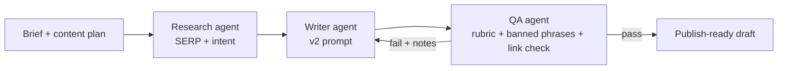

# Deployment pattern: one custom GPT per client

The agent runs as **one ChatGPT custom GPT per client site**. Each one shares the same system prompt and differs only in client configuration and knowledge.

| GPT component | Contents |
|---|---|
| Instructions | `prompts/system-prompt-v2.md` with the client placeholders filled in |
| Knowledge | The client's content plan (keywords, target pages, approved internal URLs) from `templates/content-plan-template.csv` |
| Capabilities | Web search on (SERP checks), code interpreter on (reads the spreadsheet), image generation optional |
| Sharing | Shared by link with the content team |

## Why per-client GPTs

- **Isolation:** one client's brand, URLs and memory never leak into another's output (failure #2 in the iteration log).
- **Simplicity for writers:** they open the client's GPT and type "Write blog".
- **One prompt to maintain:** improvements to the base prompt roll out by re-pasting it.

## State of the client GPTs (Nov 2026)

Four client GPTs existed. In two, the instructions held only the client website and the knowledge held the content plan. The full v2 prompt had not yet been rolled out to them. One was empty, and one was an unpublished draft. Rolling v2 out with each client's config is the next step.

## Proposed (not built): multi-agent split

Splitting research, writing and QA would make each step testable on its own. It's documented here as a design option only.
